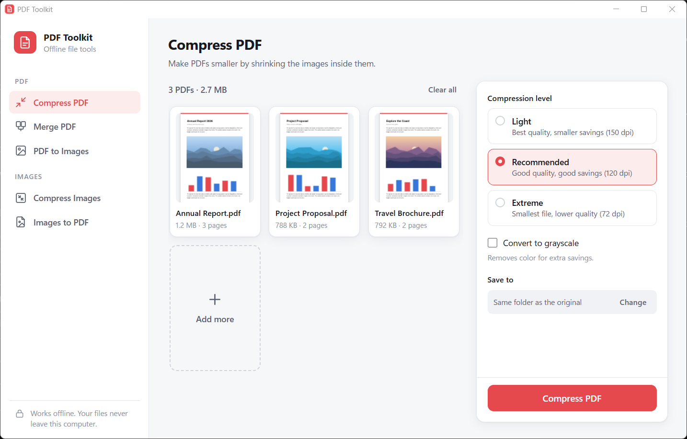
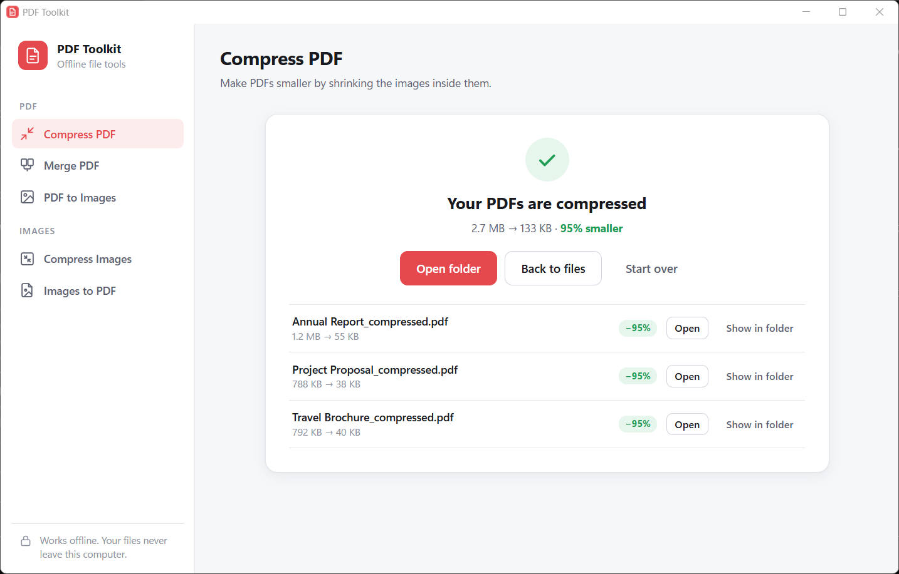
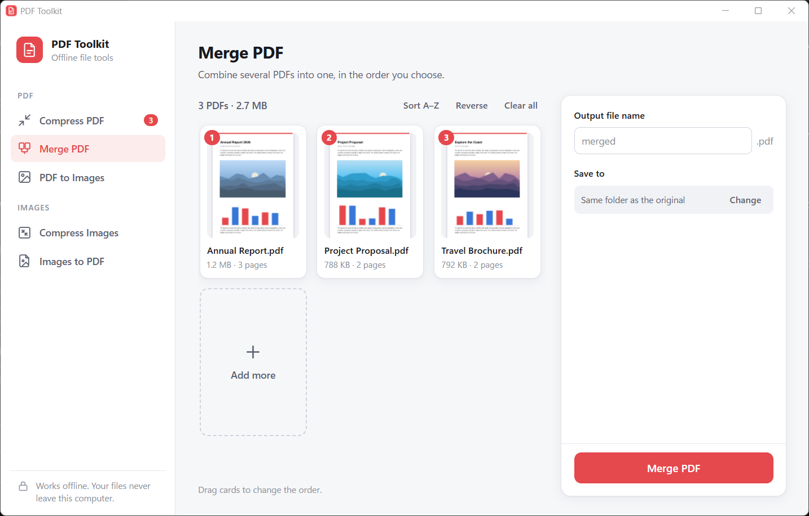
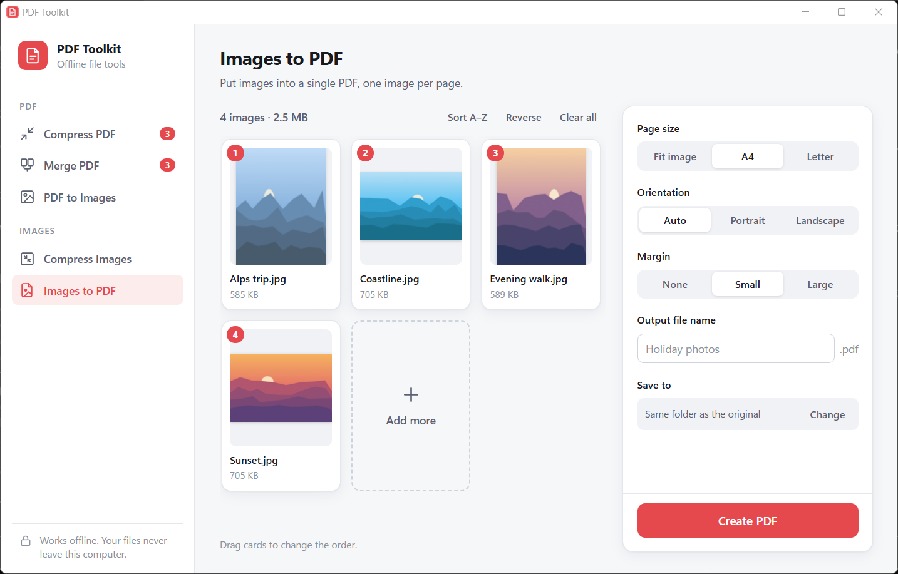
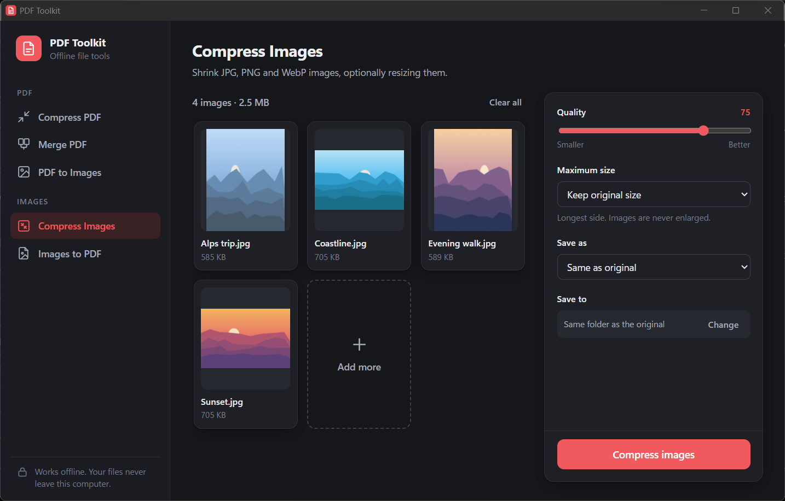

# PDF Toolkit

A small, fully offline Windows app for everyday PDF and image chores. Nothing is
uploaded anywhere: every file is processed on your own computer.



| Tool | What it does |
| --- | --- |
| **Compress PDF** | Shrinks the images inside a PDF. Three levels: Light (150 dpi), Recommended (120 dpi), Extreme (72 dpi), plus optional grayscale. |
| **Merge PDF** | Combines PDFs into one file in the order you arrange. |
| **PDF to Images** | Saves pages as PNG or JPG at 72, 150 or 300 dpi, with optional page ranges such as `1-3, 5`. |
| **Compress Images** | Re-encodes JPG, PNG, WebP, BMP and TIFF images with a quality slider, optional resizing and format conversion. |
| **Images to PDF** | Puts images into one PDF, one per page: fit to the image, A4 or Letter, with margins. JPEG and PNG files are embedded without recompression. |

You can drag files or whole folders onto the window, or click **Select files**.
Results are saved next to the originals by default (for example
`report_compressed.pdf`); existing files are never overwritten.

## Screenshots

| | |
| --- | --- |
|  |  |
| **Results:** see how much space each file saved | **Merge PDF:** drag cards to set the order |
|  |  |
| **Images to PDF:** A4, Letter or fit-to-image pages | **Dark mode:** follows your Windows theme |

## Download and run

Download `PDF Toolkit.exe` from the Releases page and double-click it. There is
nothing to install.

- **Requirements:** 64-bit Windows 10 or 11. The interface uses Microsoft Edge
  WebView2, which comes with Windows 11 and up-to-date Windows 10. On older
  systems, install the free
  [WebView2 Runtime](https://developer.microsoft.com/microsoft-edge/webview2/).
- **"Windows protected your PC":** the exe isn't code-signed, so SmartScreen may
  warn the first time. Click **More info → Run anyway**.

## Good to know

- Compression works by shrinking images. PDFs that are mostly text are usually
  already small, so they won't shrink much. If a result would be larger than the
  original, the original is kept unchanged.
- Password-protected PDFs are skipped, and the app tells you which ones.

## Development

You need Python 3.12 on Windows.

```powershell
py -3.12 -m venv .venv
.\.venv\Scripts\pip install -r requirements.txt -r requirements-dev.txt
.\.venv\Scripts\python app\main.py          # run from source
.\.venv\Scripts\python -m unittest discover -s tests
.\build.ps1                                 # tests + build dist\PDF Toolkit.exe
```

Set `PDF_TOOLKIT_DEBUG=1` before running to get the browser dev tools.

### Layout

```
app/
  main.py      window, Python <-> UI bridge, file drag-and-drop
  ops.py       the actual PDF/image operations (no UI code)
  ui/          HTML, CSS and JS for the interface (no external resources)
tests/         unit tests for ops.py
scripts/       make_icon.py regenerates assets/icon.ico
docs/          README screenshots
packaging/     Windows version info embedded in the exe
build.ps1      one-step build with PyInstaller
```

Built with [PyMuPDF](https://pymupdf.readthedocs.io/), [Pillow](https://python-pillow.org/),
[pywebview](https://pywebview.flowrl.com/) and [PyInstaller](https://pyinstaller.org/).

## License

[GNU AGPL-3.0](LICENSE), because PyMuPDF is AGPL-licensed.
